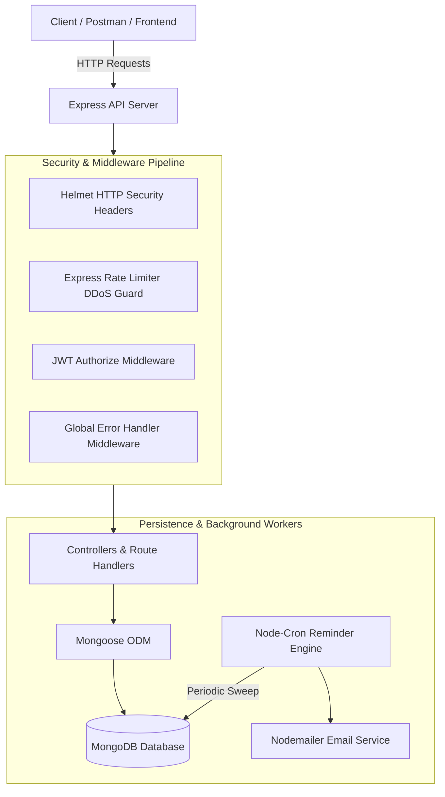

# 🔔 Subscription Tracker API

[](https://nodejs.org/)
[](https://expressjs.com/)
[](https://www.docker.com/)
[](https://www.mongodb.com/)
[](https://www.postman.com/)
[](LICENSE)

A production-grade, containerized RESTful API engineered with **Node.js (ES Modules)**, **Express**, and **MongoDB**. The platform manages recurring subscription lifecycles, tracks payment cadences, enforces rate limiting and HTTP security headers, and automates renewal notifications via an integrated background Cron engine.

---

## 📑 Table of Contents

- [System Architecture](#-system-architecture)
- [Key Features](#-key-features)
- [Tech Stack](#-tech-stack)
- [Project Layout](#-project-layout)
- [Quickstart with Docker (Recommended)](#-quickstart-with-docker-recommended)
- [Manual Local Setup](#-manual-local-setup)
- [Environment Configuration](#-environment-configuration)
- [API Reference](#-api-reference)
- [Automated Postman Testing](#-automated-postman-testing)
- [Security & Production Hardening](#-security--production-hardening)
- [Contributing](#-contributing)
- [License](#-license)

---

## 🏛️ System Architecture



---

## ✨ Key Features

- **Enterprise Security:** Hardened with `helmet`, IP-based `express-rate-limit`, cookie parsing, and HTTP-only protections.
- **Robust Authentication:** Secure registration and login using JSON Web Tokens (JWT) and `bcryptjs` password hashing with custom complexity validations.
- **Role-Based Access Control:** Dual role capability (`user` vs `admin`) with secret key privilege elevation.
- **Full Subscription Lifecycle:** Granular CRUD operations with custom cadences (`daily`, `weekly`, `monthly`, `yearly`), currency support (`USD`, `EUR`, `GBP`, `INR`), and cancellation flows.
- **Automated Cron Scheduler:** Autonomous background jobs scan upcoming renewals and trigger alerts while guarding against spam and duplicate triggers.
- **Containerized Out-of-the-Box:** Multi-container setup with Docker and Docker Compose orchestrates the API and MongoDB database with persistent volume storage.
- **Automated Postman Test Suite:** Complete test collection with dynamic JWT token chaining, assertions, and zero-warning collection-level authentication.

---

## 🛠️ Tech Stack

| Layer | Technology |
|---|---|
| **Runtime & Engine** | Node.js (v20+ LTS, ES Modules `"type": "module"`) |
| **Framework** | Express.js |
| **Database & ODM** | MongoDB 7.0 via Mongoose 9.x |
| **Containerization** | Docker, Docker Compose |
| **Authentication** | JWT (`jsonwebtoken`), Password Hashing (`bcryptjs`) |
| **Automation & Jobs** | Node-Cron (`node-cron`) |
| **Email Transport** | Nodemailer (`nodemailer`) |
| **Security Tooling** | Helmet (`helmet`), Rate Limiting (`express-rate-limit`) |
| **Testing Suite** | Postman Collection v2.1.0, Newman CLI |

---

## 📂 Project Layout

```text
Subscription-Tracker-API/
├── config/             # Environment loader and Cron scheduler initializers
├── controllers/        # Business logic for auth, users, and subscriptions
├── database/           # MongoDB connection handlers
├── middleware/         # Auth verification, rate limiting, and error handling
├── models/             # Mongoose schemas with global validators
├── postman/            # Automated test collections and environment definitions
├── routes/             # RESTful API route definitions
├── utils/              # Reminder calculators and email dispatch utilities
├── .dockerignore       # Docker build context exclusions
├── .env.example        # Reference environment variable blueprint
├── .gitignore          # Git exclusion rules
├── app.js              # Server entry point and middleware pipeline
├── docker-compose.yml  # Multi-container orchestration (API + Mongo)
├── Dockerfile          # Multi-stage production container blueprint
└── package.json        # Project metadata and dependencies
```

---

## 🐳 Quickstart with Docker (Recommended)

Run the entire application along with MongoDB in isolated containers with **one command**:

### 1. Prerequisites
- [Docker Desktop](https://www.docker.com/products/docker-desktop/) installed and running.

### 2. Launch Containers
```bash
# Clone the repository
git clone https://github.com/gnanasaidevarakonda/Subscription-Tracker-API.git
cd Subscription-Tracker-API

# Spin up both API and MongoDB
docker compose up --build
```

The API will automatically connect to MongoDB and start listening at:
👉 **`http://localhost:5400`**

To stop the containers:
```bash
docker compose down
```

---

## 💻 Manual Local Setup

If you prefer to run the application directly on your host machine:

### 1. Prerequisites
- [Node.js](https://nodejs.org/) (v18 or higher)
- [MongoDB](https://www.mongodb.com/) running locally or a [MongoDB Atlas](https://www.mongodb.com/cloud/atlas) connection URI.

### 2. Installation Steps
```bash
# 1. Install dependencies
npm install

# 2. Configure environment
cp .env.example .env.development.local

# 3. Start development server
npm run dev
```

The server boots on `http://localhost:5400`.

---

## ⚙️ Environment Configuration

Refer to [`.env.example`](.env.example) for the full list of supported environment variables:

| Variable | Required | Default | Description |
|---|:---:|---|---|
| `PORT` | No | `5400` | Port on which the Express server listens |
| `NODE_ENV` | No | `development` | Runtime environment (`development`, `production`) |
| `DB_URI` | **Yes** | — | MongoDB connection URI (`mongodb://mongo:27017/...` in Docker) |
| `JWT_SECRET` | **Yes** | — | Secret key used to sign and verify JWT tokens |
| `JWT_EXPIRES_IN` | No | `7d` | Token expiration duration (e.g., `1d`, `7d`) |
| `ADMIN_kEY` | No | — | Secret passphrase to grant `admin` role upon registration |
| `EMAIL_ACCOUNT` | No | — | SMTP email address for reminder notifications |
| `EMAIL_PASSWORD` | No | — | SMTP application-specific password |

---

## 📖 API Reference

Base URL: `http://localhost:5400/api/v1`

### 🔐 Authentication (`/auth`)
| Method | Endpoint | Description | Auth Required |
|:---:|---|---|:---:|
| `POST` | `/auth/sign-up` | Register new user account and obtain JWT token | Public |
| `POST` | `/auth/sign-in` | Authenticate user credentials and issue JWT token | Public |
| `POST` | `/auth/sign-out` | Terminate session and clear cookies | Public |

### 👤 User Management (`/users`)
| Method | Endpoint | Description | Auth Required |
|:---:|---|---|:---:|
| `GET` | `/users` | Retrieve all registered users | Bearer JWT |
| `GET` | `/users/:id` | Retrieve user profile by ID | Bearer JWT |
| `PUT` | `/users/:id` | Update profile information | Bearer JWT |
| `DELETE` | `/users/:id` | Delete user account | Bearer JWT |

### 💳 Subscriptions (`/subscriptions`)
| Method | Endpoint | Description | Auth Required |
|:---:|---|---|:---:|
| `POST` | `/subscriptions` | Create a new recurring subscription | Bearer JWT |
| `GET` | `/subscriptions` | Fetch all platform subscriptions | Bearer JWT |
| `GET` | `/subscriptions/:id` | Fetch specific subscription details | Bearer JWT |
| `GET` | `/subscriptions/user/:id` | Fetch all subscriptions belonging to a user | Bearer JWT |
| `GET` | `/subscriptions/upcoming-renewals`| List subscriptions due for upcoming renewal | Bearer JWT |
| `PUT` | `/subscriptions/:id` | Update subscription details | Bearer JWT |
| `PUT` | `/subscriptions/:id/cancel` | Cancel an active subscription | Bearer JWT |
| `DELETE`| `/subscriptions/:id` | Permanently remove a subscription | Bearer JWT |

---

## 🧪 Automated Postman Testing

This repository includes a production-grade automated Postman test suite in the [`postman/`](postman/) directory:
- **`Subscription_Tracker_Collection.json`**: Complete request collection with automated test assertions and native collection-level auth.
- **`Subscription_Tracker_Env.json`**: Pre-configured environment variables (`baseUrl`, `authToken`, `userId`, `subscriptionId`).

### Running Tests in Postman GUI:
1. Open Postman $\rightarrow$ Click **Import** $\rightarrow$ Select both files from the `postman/` folder.
2. Select the **Subscription Tracker (Local)** environment in the top-right corner.
3. Click the collection options `...` $\rightarrow$ **Run Collection** $\rightarrow$ Click **Run Subscription Tracker API**.
4. Authentication tokens chain dynamically and all tests execute sequentially.

### Running Headless via Newman CLI:
```bash
npx newman run postman/Subscription_Tracker_Collection.json -e postman/Subscription_Tracker_Env.json
```

---

## 🛡️ Security & Production Hardening

- **HTTP Security Headers:** Protected by `helmet` to mitigate clickjacking, XSS, and MIME-type sniffing.
- **Rate Limiting:** `express-rate-limit` throttles brute-force attempts on sensitive endpoints.
- **Input Sanitization:** Custom Mongoose schema validators enforce email formatting, secure password complexity, and price minimums.
- **Container Isolation:** Alpine-based Node container running unprivileged runtime commands with layer caching.

---

## 🤝 Contributing

Contributions, issues, and feature requests are welcome!

1. Fork the Project.
2. Create your Feature Branch (`git switch -c feature/AmazingFeature`).
3. Commit your Changes (`git commit -m 'feat: add some AmazingFeature'`).
4. Push to the Branch (`git push origin feature/AmazingFeature`).
5. Open a Pull Request.

---

## 📄 License

Distributed under the **MIT License**. See [`LICENSE`](LICENSE) for more information.

---

## 👨‍💻 Author

**Gnana Sai Devarakonda**
- GitHub: [@gnanasaidevarakonda](https://github.com/gnanasaidevarakonda)